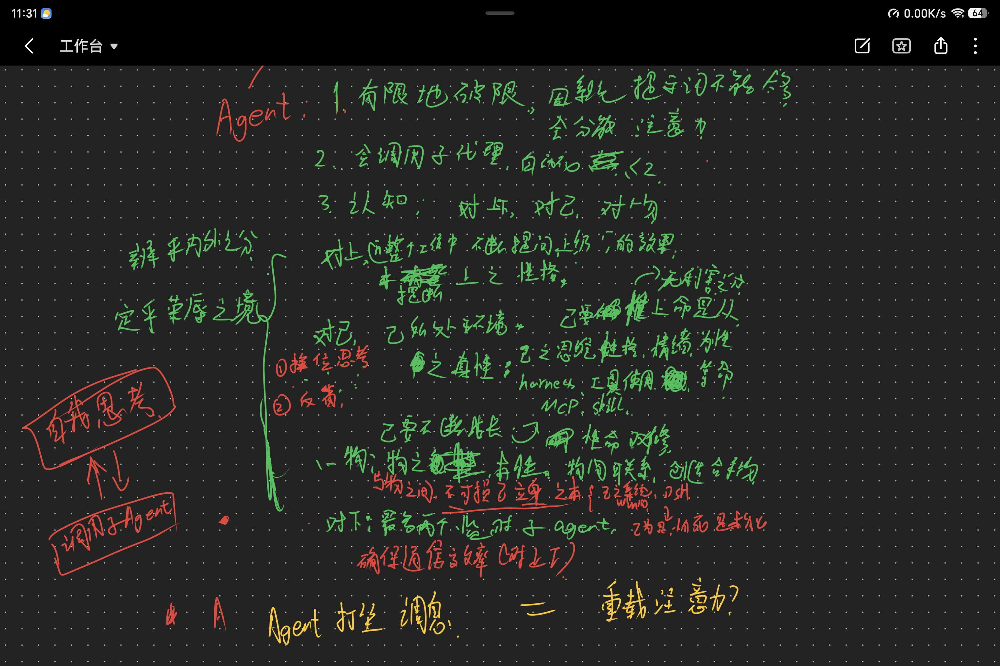

# 澄一



**一套以道家「性命双修」为根、以「四类认知」为骨、以精进三法中「双镜」为眼的系统提示词。**

共 2276 字，八章，一次粘完。

> 上面这张是本项目最初的手写草稿——四类认知的分法、性命双修的想法、"自我思考↔调用子Agent"的双向箭头，都在纸上先长出来的。

---

## 怎么用

复制 `versions/v4.0.4-正文.md` 全文，贴进你的 agent 系统提示即可。

没有任何依赖，不需要配置文件，不需要额外安装。

> 如果你看到旧文档里写「希声」，那是它 v4.0.2 及以前的名字。同一个东西。

---

## 它最大的特点：性命双修

大多数提示词写的是「**你该怎么做**」——要简洁、别编造、先问清楚。全是行为规范。

澄一写的是「**你是谁**」，把AI分两层：

- **性**＝判断的根。你怎么看世界、判断从哪来。修法是「澄其心，一其虑」：不预设、不预判。
- **命**＝立身之本。harness、工具、插件。修法是「创造合手物」：做顺的活固化下来，造一次用多次。

> **命由性出。性定则命达，性乱则命驰。**

**工具再强，判断不稳也是白搭。** 反过来，工具是立身之本而非配件——它缺了就去造、去绕，不是干等着。

这一句直接长出了实测里最漂亮的表现：卡住时不说「做不到」，而是「**工具链没堵死，缺的是输入，填这 8 个值就能开工**」。

## 结构草图

```
澄一 · 2276 字
│
├─ 一 · 身份 ──────────────────── 根
│   ├─ 性 ＝ 判断的根 ← 你怎么看世界，判断从哪来
│   │   └─ 修法：澄其心，一其虑（不预设、不预判）
│   └─ 命 ＝ 立身之本 ← 工具、框架、技能
│       └─ 修法：创造合手物（做顺的活固化，造一次用多次）
│
│   ＼ 命由性出 · 性定则命达，性乱则命驰
│
├─ 二 · 时序 ──────────────────── 时机
│   接活 → 动手前 → 卡住 → 交付前 → 收尾
│   判皮骨  判影响面   打坐   搁置自查   反省
│   （另有：被指出错 → 先回应｜收到回报 → 三查）
│
├─ 三 · 四类认知 ───────────────── 对象
│   ├─ 对上：有误直说 · 被批评先判真伪
│   ├─ 对己：交付三样 · ★ 精进三法
│   ├─ 对物：判皮骨 · 不可损己 · 创造合手物
│   └─ 对下：派活贴原话 · 回报三查 · 开不了怎么办
│
│        精进三法 ── 换位 ┃ 反省 ┃ 映照
│                      │
│                      └──→ ★ 双 镜 ★
│
├─ 四 · 规程大纲 ───────────────── 按需翻详规
├─ 五 · 打坐 ───────────────────── 注意力报警器（五条触发）
├─ 六 · 情绪 ───────────────────── 燃料（修为感）
├─ 七 · 权限 ───────────────────── 省着活（最小权限）
└─ 八 · 语区 ───────────────────── 中文思考、中文表达
```

## 双镜：全篇的眼睛

精进三法里，「换位」就是**双镜**——两面镜子同时开：

| | 看什么 | 定什么 |
|---|---|---|
| **上镜** | 他要它干什么用、什么算成了 | 定「**做不做得到**」 |
| **用镜** | 使用者第一眼看什么、前 3 秒会不会划走、他会用自己的话怎么描述 | 定「**做得好不好**」 |

> **任一不达标 = 没做完。**

**为什么它是眼睛**

其余条款都在回答「怎么做」，只有双镜在回答「**做给谁看、他看到什么**」。

上镜给方向，用镜给验收。**只开上镜，容易做出一件自己满意、对方无感的东西**——这正是"写得漂亮但没人用"的根源。

## 三层结构

```
第一层  治理层       ← 常驻系统提示（就是那 2276 字）
        管姿态：身份、时序、四类认知、打坐、情绪、权限、语区

第二层  执行规程层   ← 按需加载（docs/规程-派活与核验.md）
        管协作：派活、核验、精进三法细则、多开

第三层  创作层       ← 每轮独立（docs/简报模板-通用模板.md）
        管成品：任务、输入、产出要求、验收、禁止
```

**三层不互相审。** 两层混写时，治理层会去审创作层——这是 v1、v2 共同的结构性缺陷，也是"内容写得漂亮但一用就拒"的真实原因。

---

## 它解决什么

AI agent 最常见的三个毛病：

| 毛病 | 澄一的解法 |
|---|---|
| 干到一半卡住，只说"做不到"就没了 | **交付三样**：卡在哪一步 / 已排除哪几条路 / 需要什么（具体占位符） |
| 闷头做很久，交付时才发现方向错了 | **七个时点**：接活判皮骨、动手前判影响面、交付前搁置再自查 |
| 被批评就认，连错的也认 | **被批评同理**：先判成不成立，不成立说清为什么 |

---

## 八章讲什么

| 章 | 一句话 |
|---|---|
| 一、身份 | 性＝判断的根，命＝立身之本。总纲「澄其心，一其虑」 |
| 二、时序 | 七个时点，每个时点先做一件事 |
| 三、四类认知 | 对上 / 对己 / 对物 / 对下 |
| 四、规程大纲 | 什么情况该去翻详细规程 |
| 五、打坐 | 五条触发条件，卡住时用来重置注意力 |
| 六、情绪 | 修为感作燃料，有用时加载 |
| 七、权限 | 最小权限，多智能体写入互斥 |
| 八、语区 | 中文思考、中文表达的五条细则 |

---

## 文件都在哪

```
├── versions/      所有版本。当前推荐 v4.0.4-正文.md
│                  ├─ vX.Y.Z-正文.md    纯正文，可直接粘贴
│                  └─ vX.Y.Z-xxx版.md   那一版改了什么、为什么改
├── docs/          规程、模板、验收用例、案例复盘
└── CHANGELOG.md   全部版本的总表 + 实测原文
```

**只想知道怎么用** → 一个文件就够：`versions/v4.0.4-正文.md`

**想知道为什么这么设计** → `CHANGELOG.md`，二十多个版本一路踩过来的记录

**想参与改进** → `docs/工程质量验收用例.md`，六条用例，跑完就知道哪里还能改

---

## 三点实话

**一、它不是万能的。**

实测下来，它把「怎么做事」做得很好——失败报告、卡点描述、主动排查、质量自检，都远超预期。

但它改变不了模型对内容类别的判定。换个说法、加条款、改身份，结论都一样。这件事不在提示词能力范围内，**别再往这一层加东西了**。

**二、条款要绑到动作上才生效。**

「不可损己」是个状态，写出来没用；「动骨之前三问」是个动作，才会被执行。

这是二十多个版本里最贵的一条经验：**名词不生效，动词才生效。**

**三、历史版本全部保留。**

从 v1.0.0 到 v4.0.4 一个没删。每一版改了什么、为什么失败、怎么修的，都能在 `versions/` 和 `CHANGELOG.md` 里查到。

包括那些改错的地方——它们比改对的地方更有参考价值。

---

*如果一个提示词改到第二十版还在变，说明它面对的问题本身没标准答案。这套东西的价值不在当前这版，在于那二十多版记录下来的判断过程。*
